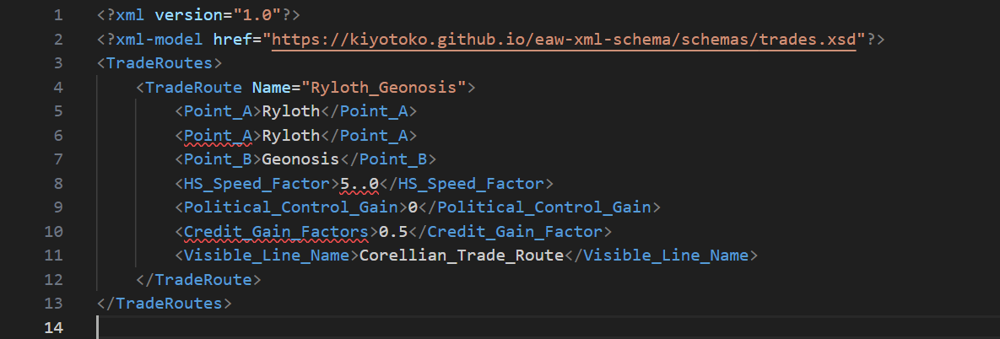

# Example

Lets consider the following xml file:

```xml
<?xml version="1.0"?>
<?xml-model href="https://kiyotoko.github.io/eaw-xml-schema/schemas/trades.xsd"?>
<TradeRoutes>
	<TradeRoute Name="Ryloth_Geonosis">
		<Point_A>Ryloth</Point_A>
		<Point_A>Ryloth</Point_A>
		<Point_B>Geonosis</Point_B>
		<HS_Speed_Factor>5..0</HS_Speed_Factor>
		<Political_Control_Gain>0</Political_Control_Gain>
		<Credit_Gain_Factors>0.5</Credit_Gain_Factors>
		<Visible_Line_Name>Corellian_Trade_Route</Visible_Line_Name>
	</TradeRoute>
</TradeRoutes>
```

This file has the following three problems:

- Point A is defined twice
- HS Speed Factor is not a float because it contains two dots
- Credit_Gain_Factors does not exist, only Credit_Gain_Factor

These errors are generally easy to spot in a short file, but many xml files in larger EaW mods have over 1000 lines.

If the file gets opened in for example VS Code, all errors will be highlighted:


